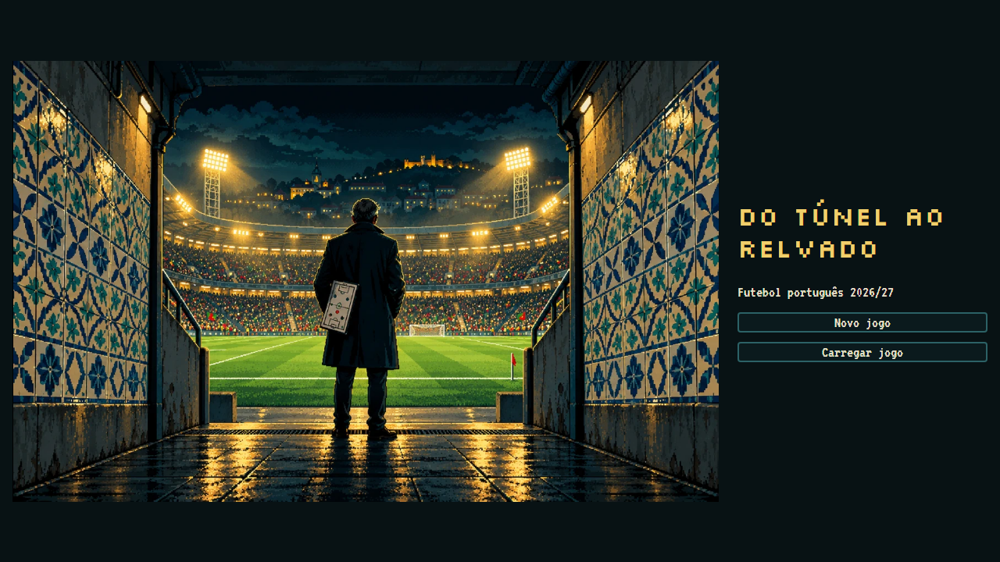
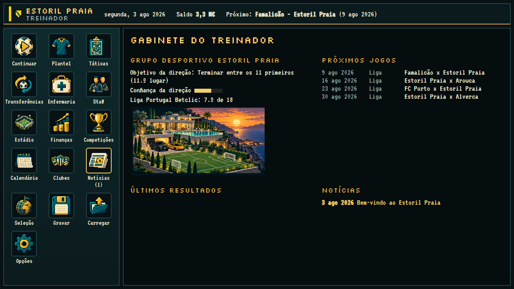
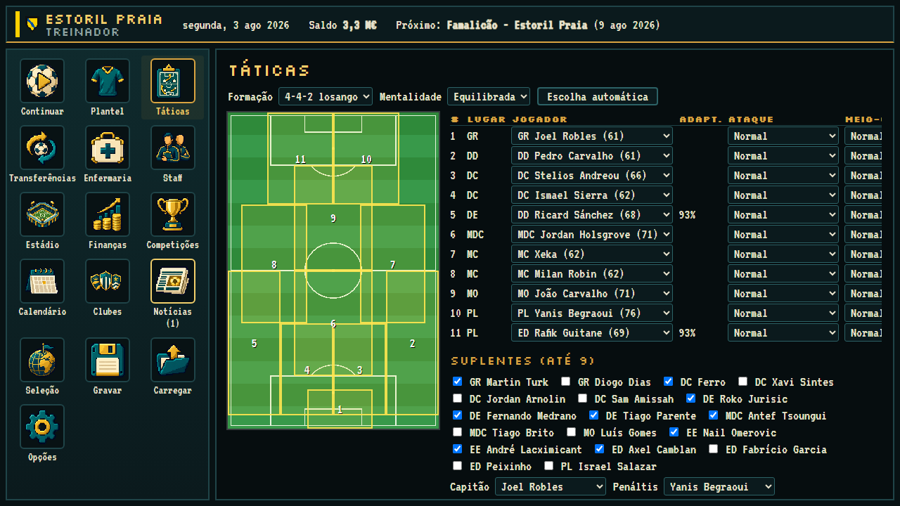
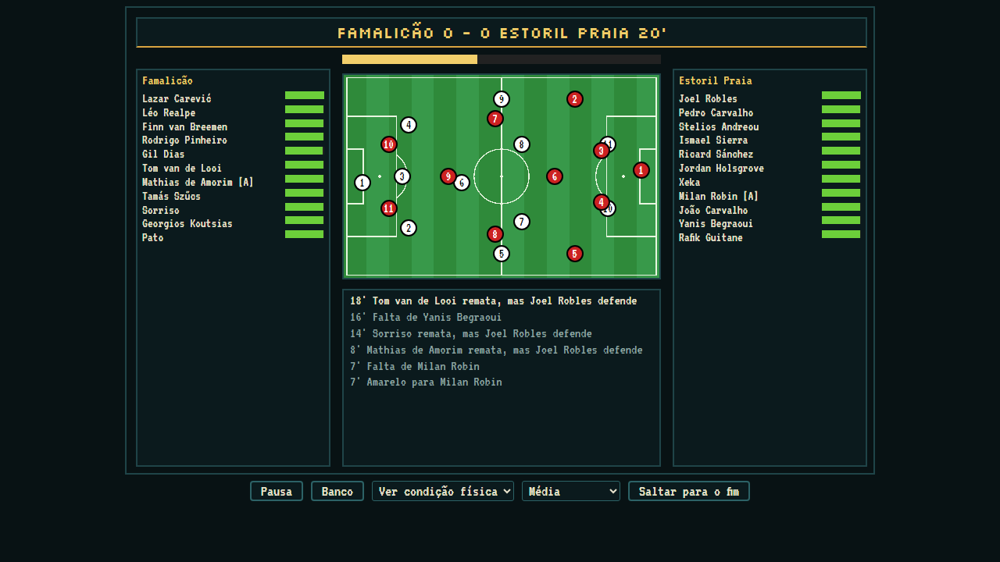
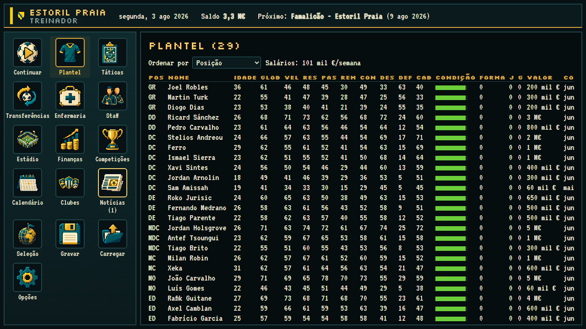
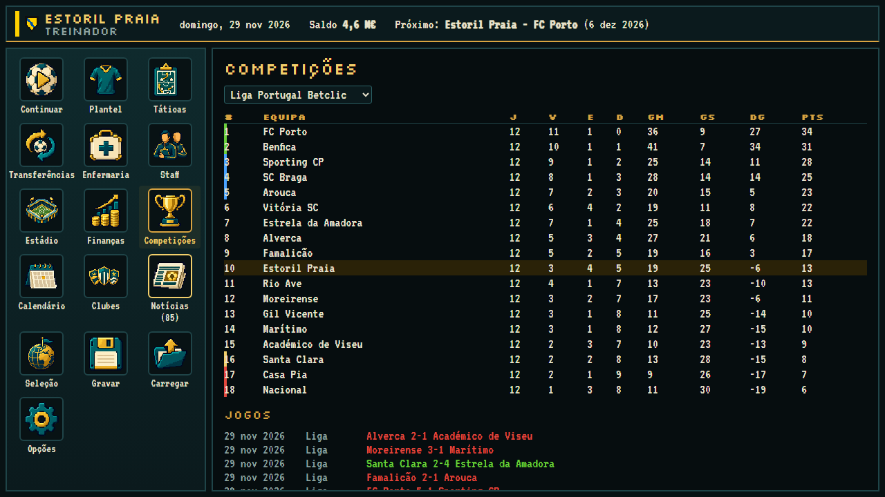
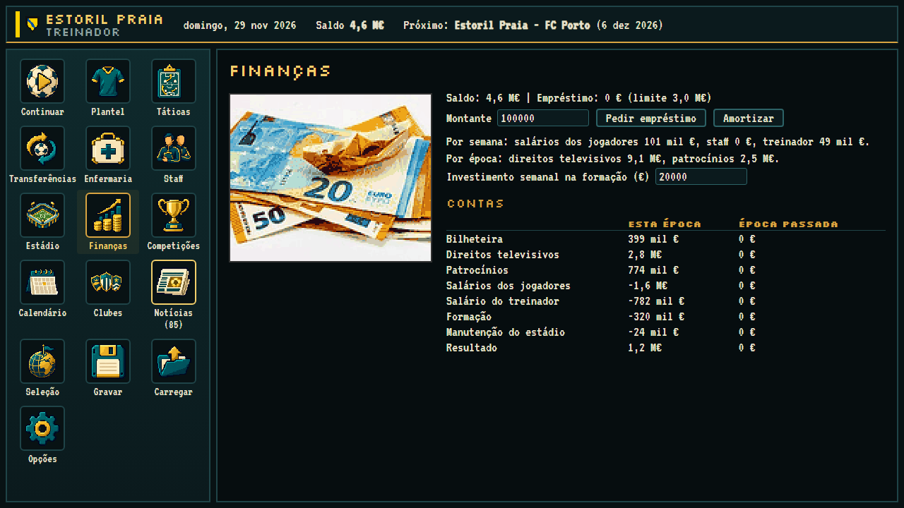
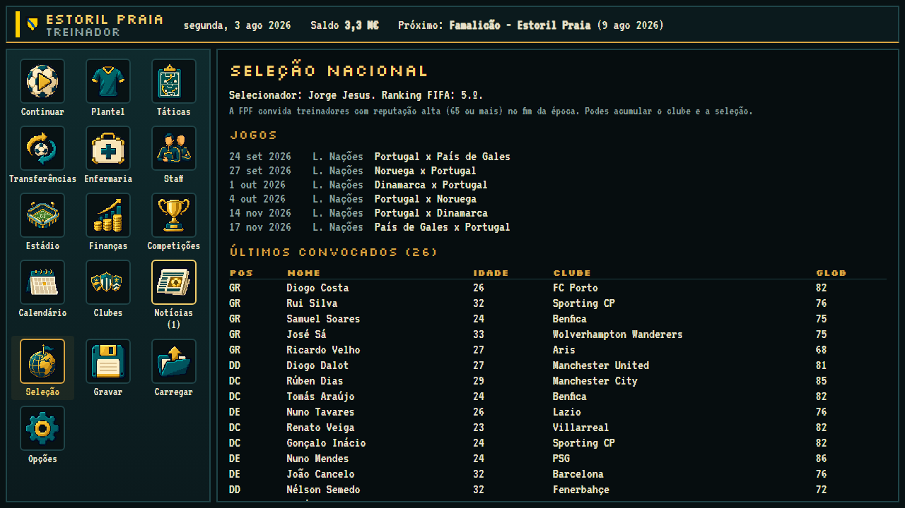

# Do Túnel ao Relvado

A football management game set in the 2026/27 Portuguese season, from the top flight down to the
district leagues, with every cup, the European competitions and the national team. Matches play
out minute by minute, with each player's zone drawn on the pitch. Runs in the browser and as an
Android app. The game is in Portuguese.

**Play it in the browser:** [exzimio.itch.io/do-tnel-ao-relvado](https://exzimio.itch.io/do-tnel-ao-relvado)

## Why I built it

Management games about Portuguese football stop at the second division. I wanted the whole pyramid,
with the real promotion and relegation rules, the real cup draws by division and the real calendar,
and a simulation that stays believable after thirty seasons instead of drifting into nonsense. It
also had to run on a phone held sideways, on a screen with 450 pixels of height.

## Screenshots

The title screen:

The manager's office: the board's objective and confidence, the next fixtures, results and news:

Tactics: formation, team mentality, each player's zone on the pitch and individual instructions:

A match in progress, with the zones of both teams, the commentary and the pictures of the key
moments:

The squad, with the eight attributes, condition, form and contract of every player:

The league table twelve rounds in, with the European and relegation places marked:

Finances in euros: gate receipts, television, sponsors, wages, youth development and stadium
upkeep, this season against last:

The national team, offered to the manager once the reputation is high enough:

## What it does

- 394 clubs: Liga (18), Liga 2 (18), Liga 3 (20, two groups and two phases), Campeonato de
  Portugal (56, four groups with play-offs), 179 district clubs and 103 foreign clubs from the
  league phases of the Champions League, Europa League and Conference League.
- The Portuguese Cup with the real entry rounds by division, the League Cup, promotion and
  relegation play-offs, B teams barred from the top flight, and the European places for the
  following season.
- The national team: Nations League with the real group and dates, Euro 2028 qualifying and finals,
  and the 2030 World Cup as co-host.
- Matches minute by minute with substitutions, formation and mentality changes from the bench,
  red cards, penalties, extra time and penalty shoot-outs.
- Finances, stand-by-stand stadium works, staff, youth development, contracts, transfers by
  auction with counter-offers, and a transfer market between the AI clubs.
- Pre-contracts that only arrive on 1 July, a bank loan with a forced sale after four weeks over
  the limit, and a board that sets objectives and loses patience.
- Eight save slots in the browser, exportable to a file; on Android the file goes through the
  share sheet.

## How it's built

- **Engine:** TypeScript with no framework and no browser dependencies, so the same code runs in
  the game, in the tests and in the command-line simulations. A seeded random number generator
  makes every run reproducible.
- **Interface:** DOM built by hand, no framework, with a compact layout for phones held sideways.
  Saves are gzip-compressed in IndexedDB.
- **Android:** the same build inside a WebView, packaged with Capacitor.
- **Data:** real squads for the top three divisions, collected from public sources in October
  2026, with the source listed for every club. Smaller clubs get generated squads at the level of
  their division.
- **Art:** pixel-art icons, houses and title of my own; stadium and match photographs from
  Wikimedia Commons, pixelised, with every author credited; player portraits and club crests
  drawn by the game itself from each id, so 3,800 players and 394 clubs need no image files.
- **Tests:** unit tests for the match engine and full-season tests with Vitest, plus a soak script
  that runs thirty seasons and checks the integrity of the world after each one.

## Interesting problems

- **A match engine calibrated against the real league.** The pitch is divided into three zones and
  each player has an area; the overlap of the areas decides who contests each moment. The engine is
  tuned to the Liga's real averages (2.7 goals, 22 shots, 4.3 yellow cards per match), and the
  three team mentalities were measured over 600 matches between equal sides so that none of them is
  a dominant choice.
- **Thirty seasons without drifting.** Long runs exposed problems a single season never shows:
  foreign national teams running out of players as they retired, foreign clubs creating money
  because they had no expenses, the big clubs shrinking into mid-table over decades. Each was fixed
  with a mechanism that mirrors reality (replacement budgets, reputation floors, youth intake by
  stature) and verified over two 30-season runs with different seeds.
- **A whole world on a phone.** The world data is a single lazy chunk of about 1 MB; portraits and
  crests are drawn on the fly from deterministic hashes instead of shipped as images. The whole
  game is 1.7 MB zipped.
- **Foreign clubs without a foreign league.** The 103 foreign clubs have no simulated league, so an
  abstract weekly championship gives them form and morale. Without it they arrived at every
  European tie neutral, and Portuguese clubs won far too much.
- **Tables that fit sideways.** The squad table has 19 columns. On a phone it scrolls sideways
  while the position and name stay fixed, so you always know whose numbers you are reading.

## What's next

- Simulated matches between foreign national teams, instead of a result by relative strength
- A smarter AI transfer market
- A full season of real data each summer

The source code is kept in a private repository. If you'd like to see it, reach out on [LinkedIn](https://www.linkedin.com/in/alexandre-magno-382a813b2/).

---

© 2026 Alexandre Magno. All rights reserved.
